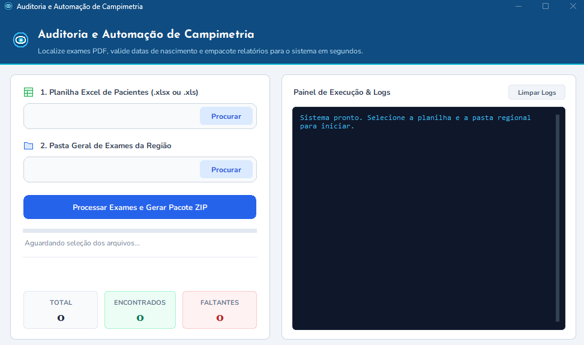
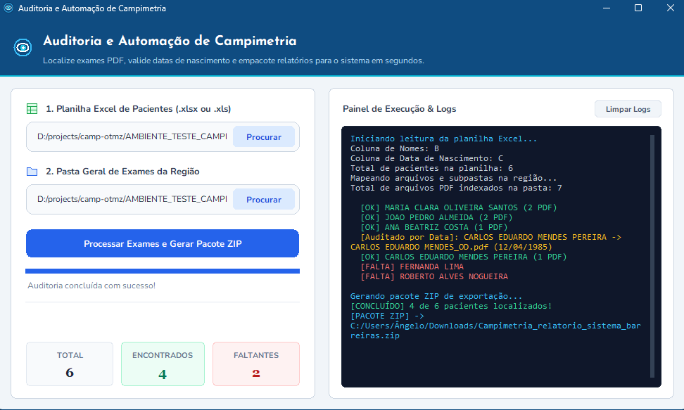

# 👁️ Auditoria e Automação de Campimetria (AutoCamp)

Aplicação desktop desenvolvida em **Python** para automatizar a localização, conferência de integridade e empacotamento de laudos de **Campimetria Computadorizada (PDF)** a partir de relatórios exportados por sistemas de gestão em saúde (`.xlsx` e `.xls`).

> **🔒 Nota sobre Propriedade Intelectual e Segurança Institucional**
> Este repositório tem caráter exclusivamente demonstrativo (portfólio técnico). Por tratar-se de uma ferramenta desenvolvida para otimizar fluxos operacionais internos e atender às diretrizes de proteção de dados sensíveis (**LGPD**), o código-fonte e os binários executáveis não são distribuídos publicamente.

>Nota de Privacidade e Simulação: As capturas acima foram geradas em ambiente de simulação (AMBIENTE_TESTE_CAMPI). Tanto a planilha utilizada quanto os nomes de pacientes e arquivos PDF exibidos nos logs são meramente ilustrativos e fictícios, criados exclusivamente para a demonstração pública deste projeto. Nenhum dado real de paciente foi exposto.

---

## 🎯 Problema Resolvido

Na rotina administrativa de faturamento e auditoria de exames oftalmológicos, a conferência manual entre listagens de pacientes e centenas de subpastas regionais gera gargalos operacionais e risco de glosas por ausência de anexos (Olho Direito — `OD` e Olho Esquerdo — `OE`).

O **AutoCamp** substitui a busca manual por um fluxo auditável em segundos:
1. Lê a planilha extraída do sistema de gestão (suportando `.xlsx`, `.xls` legado e tabelas HTML/CSV exportadas com extensão `.xls`).
2. Varre recursivamente toda a estrutura de diretórios e subpastas da região selecionada.
3. Cruza os pacientes da planilha com os laudos PDF disponíveis e valida a titularidade do exame.
4. Gera um pacote `.zip` pronto para envio, contendo uma planilha auditada (com destaque visual em verde/vermelho e hiperlinks relativos) e as pastas organizadas de cada paciente localizado.

---

## 🖥️ Interface e Demonstração

### 1. Tela Inicial e Configuração da Auditoria
Interface em arquitetura *Split-View* (duas colunas) projetada para operação rápida: seleção dos insumos à esquerda e console de monitoramento em tempo real à direita.

---

### 2. Execução Concluída e Auditoria por Data de Nascimento
Exemplo de execução validando 6 pacientes frente a 7 laudos distribuídos em subpastas regionais, com atualização dos indicadores (**Total**, **Encontrados** e **Faltantes**) e log detalhado por status:

**Cenários validados na execução acima:**
* **Match por Pasta ou Arquivo (`[OK]`):** Localiza tanto pastas dedicadas com o nome do paciente (mesmo quando os PDFs internos possuem códigos proprietários do equipamento) quanto arquivos avulsos com sufixos de lateralidade (`_OD`, `- OE`), validando positivamente mesmo quando há exame de apenas um olho.
* **Dupla Validação por Data de Nascimento (`[Auditado por Data]`):** Quando o nome do arquivo possui divergência parcial (como ausência de sobrenome), o sistema lê o texto interno do PDF e compara com a data de nascimento da planilha (convertendo automaticamente formatos ISO `AAAA-MM-DD` para `DD/MM/AAAA`), aprovando apenas se houver correspondência exata.
* **Bloqueio de Homônimos (`[FALTA]`):** Arquivos com nomes semelhantes, mas data de nascimento divergente, são descartados automaticamente para impedir falsos positivos.

---

## ⚙️ Principais Funcionalidades

* **Processamento 100% Offline (Privacy by Design):** Toda a leitura de planilhas, extração de texto de PDFs e compactação ocorre localmente na máquina do operador, sem tráfego de dados médicos em nuvem.
* **Leitura Resiliente de Planilhas:** Tratamento automático para arquivos `.xls` corrompidos ou exportados como relatórios HTML/CSV por sistemas hospitalares.
* **Planilha Auditada com Hiperlinks Locais:** O relatório gerado colore em **verde** os pacientes localizados, em **vermelho** os pendentes e cria links relativos (`./NOME_DO_PACIENTE`) que abrem diretamente a pasta de exames ao clicar.
* **Preservação de Estrutura:** Copia pastas originais já organizadas sem criar diretórios duplicados e agrupa arquivos avulsos em pastas padronizadas dentro do `.zip` final.

---

## 🛠️ Stack Tecnológica

* **Linguagem:** Python 3.14
* **Interface Gráfica (GUI):** Tkinter / Canvas Customizado (componentes arredondados, barra de progresso, indicadores KPI e terminal de logs com codificação por cores)
* **Manipulação de Planilhas:** `openpyxl` & `xlrd`
* **Leitura e Auditoria de PDFs:** `pypdf`
* **Empacotamento Standalone:** `PyInstaller` (executável portátil sem necessidade de instalação no ambiente de trabalho)